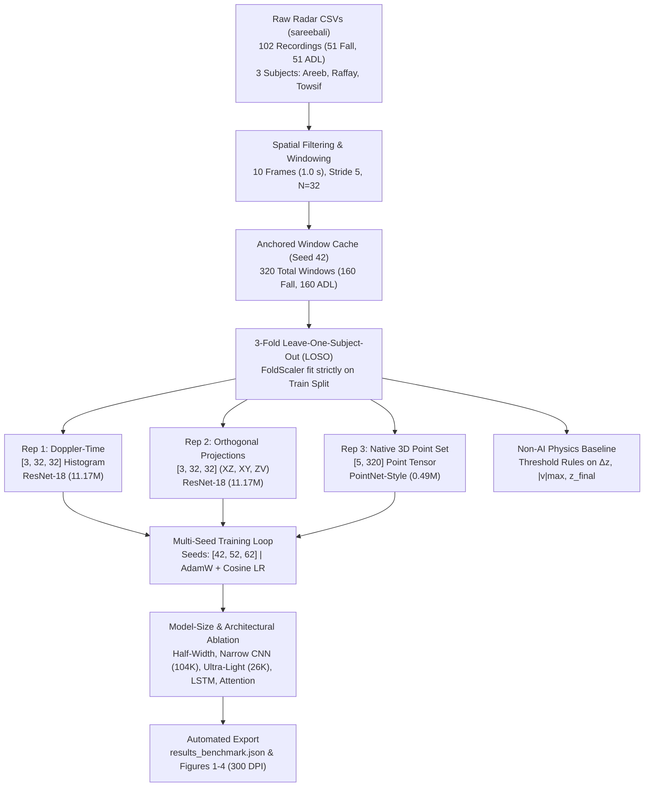

# Comparative Evaluation of mmWave Radar Data Representations for Contactless Fall Detection in Ambient Assisted Living

[-blue.svg)](./Comparative%20Evaluation%20of%20mmWave%20Radar%20Data%20Representations%20for%20Contactless%20Fall%20Detection%20in%20Ambient%20Assisted%20Living%20-%20Joey%20van%20der%20Poel.docx)
[](https://github.com/sareebali/mmwave-radar-fall-detection)
[](#zero-leakage-validation-protocol)
[](#reproducibility-pipeline)
[](https://www.python.org/)
[](https://pytorch.org/)

Official research codebase and reproducibility pipeline for the paper:
> **"Comparative Evaluation of mmWave Radar Data Representations for Contactless Fall Detection in Ambient Assisted Living"**  
> **Author**: Joey van der Poel *(Student Number: 500904866 | October 2026)*  
> **Manuscript Document**: [`Comparative Evaluation of mmWave Radar Data Representations for Contactless Fall Detection in Ambient Assisted Living - Joey van der Poel.docx`](./Comparative%20Evaluation%20of%20mmWave%20Radar%20Data%20Representations%20for%20Contactless%20Fall%20Detection%20in%20Ambient%20Assisted%20Living%20-%20Joey%20van%20der%20Poel.docx)  
> **Raw Dataset Repository**: [sareebali/mmwave-radar-fall-detection](https://github.com/sareebali/mmwave-radar-fall-detection)  
> **Index Terms**: *ambient assisted living, fall detection, leave-one-subject-out validation, mmWave radar, point clouds.*

---

## Abstract

Falls among older adults are a major cause of fatal injury, and monitoring is held back because people do not wear devices and cameras raise privacy concerns. Millimeter-wave (mmWave) radar protects privacy, but low-cost single-chip sensors give sparse point clouds (10–19 points per frame). Earlier studies compare radar representations with different networks or data splits that leak subject identity.

This paper compares three representations of the same Texas Instruments IWR6843 recordings (102 recordings, 320 windows, three subjects): **Doppler-Time Maps (Rep 1)**, **2D Orthogonal Projections (Rep 2)**, and **Native 3D Point Sets (Rep 3)**. Rep 1 and Rep 2 use a ResNet-18, and Rep 3 a PointNet-style network inspired by PointNet++, with 3-fold Leave-One-Subject-Out (LOSO) validation and three deterministic seeds (`42`, `52`, `62`).

**Rep 3 performed best on unseen subjects** (Macro F1 = $83.0 \pm 1.9\%$, ROC-AUC = $91.6 \pm 2.3\%$), had the lowest false-alarm rate ($13.1\%$ versus $23.1\%$ and $45.8\%$), and was the fastest ($8.2\text{ ms}$ per window) with 23 times fewer parameters ($0.49\text{M}$ vs. $11.17\text{M}$). Rep 2 reached $70.6 \pm 1.5\%$ Macro F1, and Rep 1 stayed close to chance ($53.0 \pm 0.6\%$).

---

## Table of Contents
1. [Reproducibility Pipeline](#reproducibility-pipeline)
   - [Master Reproducibility Notebook](#master-reproducibility-notebook)
   - [Deterministic Multi-Seed Protocol](#deterministic-multi-seed-protocol)
   - [Fast Smoke Test Mode](#fast-smoke-test-mode)
   - [CLI Execution Engine](#cli-execution-engine)
2. [Research Questions & Core Hypothesis](#research-questions--core-hypothesis)
3. [Empirical Benchmark Results](#empirical-benchmark-results)
   - [Held-Out Performance (Table II)](#held-out-performance-table-ii)
   - [Confounder False Alarms & Confusion Counts (Table III)](#confounder-false-alarms--confusion-counts-table-iii)
   - [End-to-End CPU Latency (Table IV)](#end-to-end-cpu-latency-table-iv)
   - [Per-Seed Stability Breakdown (Tables AII & AIII)](#per-seed-stability-breakdown-tables-aii--aiii)
4. [Model-Size & Architectural Ablation Analysis (Table V)](#model-size--architectural-ablation-analysis-table-v)
5. [Clinical & Theoretical Framework](#clinical--theoretical-framework)
   - [Clinical Need & Confounders](#clinical-need--confounders)
   - [Literature Matrix (Table AI)](#literature-matrix-table-ai)
6. [Dataset Provenance & Preprocessing Sequence](#dataset-provenance--preprocessing-sequence)
   - [Texas Instruments IWR6843 Hardware Specs (Table I)](#texas-instruments-iwr6843-hardware-specs-table-i)
   - [Zero-Leakage 3-Fold LOSO Protocol](#zero-leakage-3-fold-loso-protocol)
   - [Preprocessing & Spatial Normalization](#preprocessing--spatial-normalization)
7. [The Three Representations](#the-three-representations)
8. [Repository Architecture](#repository-architecture)
9. [Installation & Setup](#installation--setup)
10. [Notebook Workflow Directory](#notebook-workflow-directory)
11. [Citation & Declarations](#citation--declarations)

---

## Reproducibility Pipeline

The master contribution of this repository is complete, push-button deterministic reproducibility. Every table, confusion matrix, metric, and figure in the paper is reproduced by executing the primary notebook.

### Master Reproducibility Notebook
The central pipeline notebook is located at:  
**[`mmWaves/ti_radar_pipeline/mmWaveReproducabilityPipeline.ipynb`](mmWaves/ti_radar_pipeline/mmWaveReproducabilityPipeline.ipynb)**

A single top-to-bottom run:
1. Ingests all 102 raw CSV recordings from [`mmWaves/datasets/mmwave-radar-fall-detection/GatheredData`](mmWaves/datasets/mmwave-radar-fall-detection/GatheredData) (sourced from [sareebali/mmwave-radar-fall-detection](https://github.com/sareebali/mmwave-radar-fall-detection)).
2. Applies bounding-box point filtering and extracts $1.0\text{ s}$ temporal windows ($10\text{ frames}$, stride $5$).
3. Resamples frames to $N = 32$ points using a dedicated random generator seeded at `42`, caching exactly 320 temporal windows in memory (160 Falls, 160 ADLs).
4. Runs strict 3-Fold Leave-One-Subject-Out (LOSO) cross-validation across three deterministic seeds (`42`, `52`, `62`) for Rep 1, Rep 2, and Rep 3.
5. Computes pooled out-of-fold metrics (Macro F1, Recall, Precision, Accuracy, ROC-AUC, Confounder FAR) and single-window inference latency.
6. Executes the complete model-size ablation suite (Half-width ResNets, Narrow CNNs, Ultra-Light CNNs, LSTM heads, Attention heads).
7. Benchmarks the non-AI physical baseline rules ($\Delta z, |v|_{\max}, z_{\text{final}}$).
8. Exports all experimental metrics to [`mmWaves/ti_radar_pipeline/models/benchmarks/results_benchmark.json`](mmWaves/ti_radar_pipeline/models/benchmarks/results_benchmark.json) and renders publication figures at 300 DPI.



### Deterministic Multi-Seed Protocol
To eliminate stochastic variability:
- **Global Seeding**: Python `random`, NumPy `np.random`, and PyTorch `torch.manual_seed` are seeded at each phase.
- **Subject-Independent Model Initializations**: In each fold, network weights are instantiated after calling `seed_everything(fold_seed)`, where:
  $$\text{fold\_seed} = \text{seed} + 10 \times \text{fold\_idx}$$
- **DataLoaders**: Every `DataLoader` operates with an explicitly seeded `torch.Generator()` ensuring batch ordering is strictly deterministic.
- **Window Resampling Anchor**: Resampling to $N=32$ points uses an isolated generator seeded at `42`, guaranteeing all models and seeds evaluate identical window instances.

### Fast Smoke Test Mode
To verify that the entire pipeline functions end-to-end without running 20 epochs per fold, set `FALL_SMOKE_TEST=1`:

```powershell
# Windows PowerShell
$env:FALL_SMOKE_TEST = "1"
jupyter nbconvert --to notebook --execute mmWaves/ti_radar_pipeline/mmWaveReproducabilityPipeline.ipynb
```

```bash
# Linux / macOS (Bash)
export FALL_SMOKE_TEST=1
jupyter nbconvert --to notebook --execute mmWaves/ti_radar_pipeline/mmWaveReproducabilityPipeline.ipynb
```
Smoke test mode executes 1 epoch per fold and completes all data loading, transformations, training passes, ablation benchmarks, and figure rendering in under 2 minutes.

### CLI Execution Engine
The pipeline can also be run directly from the command line:
```bash
cd mmWaves/ti_radar_pipeline
python -m src.pipeline
```
This triggers `run_loso_benchmark()` from [`mmWaves/ti_radar_pipeline/src/pipeline.py`](mmWaves/ti_radar_pipeline/src/pipeline.py) and outputs results to [`mmWaves/ti_radar_pipeline/models/benchmarks/loso_benchmark_results.json`](mmWaves/ti_radar_pipeline/models/benchmarks/loso_benchmark_results.json).

---

## Research Questions & Core Hypothesis

### Research Questions
- **Primary RQ**: How does the mmWave data representation affect generalization to unseen subjects, robustness to confounders, and practicality for contactless fall detection?
- **Sub-RQ 1 (Effectiveness)**: Which representation achieves the highest Macro F1 and area under the ROC curve (ROC-AUC) under 3-fold LOSO validation?
- **Sub-RQ 2 (Confounder Robustness)**: To what extent do spatial representations (2D projections and 3D point sets) reduce false alarms on non-fall activities, including the squats and bows that resemble falls, compared with Doppler-time maps (Rep 1)?
- **Sub-RQ 3 (Latency)**: How long does each representation take from input to output, compared with the 100 ms limit of the 10 Hz stream?

### Core Hypothesis (H1)
> **Hypothesis (H1)**: Native 3D Point Sets (Rep 3) processed by a PointNet-style network inspired by Qi et al. [8] will achieve higher classification performance, higher sensitivity, and lower false-alarm rates than pixel-grid formats (Rep 1, Rep 2), because working on continuous per-point inputs avoids:
> 1. Coordinate rounding loss from spatial binning,
> 2. Severe spatial sparsity (over 90% empty pixels in 2D grids),
> 3. Multi-planar coordinate collapse (splitting joint 3D spatial geometry across disconnected 2D projection planes).

---

## Empirical Benchmark Results

All evaluations use strict 3-fold LOSO cross-validation across 3 deterministic seeds (`42`, `52`, `62`). In each seed, predictions from the three held-out folds are pooled into 320 test windows (160 Falls, 160 ADLs). Results are reported as $\text{mean} \pm \text{std}$ over the 3 seeds.

### Held-Out Performance (Table II)
*Rep 1, Rep 2: ResNet-18 (11.17M parameters); Rep 3: PointNet-style (0.49M parameters).*

| Format | Macro F1 (%) | Recall (%) | Precision (%) | Accuracy (%) | ROC-AUC (%) |
|---|:---:|:---:|:---:|:---:|:---:|
| **Rep 1: Doppler-Time** | $53.0 \pm 0.6$ | $52.3 \pm 7.0$ | $53.3 \pm 0.9$ | $53.2 \pm 0.7$ | $55.2 \pm 0.4$ |
| **Rep 2: 2D Projections** | $70.6 \pm 1.5$ | $64.6 \pm 1.9$ | $73.8 \pm 2.9$ | $70.7 \pm 1.5$ | $80.2 \pm 1.2$ |
| **Rep 3: 3D Point Sets** | **$83.0 \pm 1.9$** | **$79.4 \pm 4.7$** | **$86.5 \pm 5.8$** | **$83.1 \pm 1.9$** | **$91.6 \pm 2.3$** |
| *Non-AI Physical Baseline* | $52.2$ | $49.4$ | $53.3$ | $53.2$ | $57.1$ |

### Confounder False Alarms & Confusion Counts (Table III)
*Counts shown for Seed 42 on 320 test windows (160 Falls, 160 ADLs); Confounder FAR is the mean $\pm$ std over all 3 seeds.*

| Representation | Conf. FAR (%) | False Positives (FP) | True Negatives (TN) | False Negatives (FN) | True Positives (TP) |
|---|:---:|:---:|:---:|:---:|:---:|
| **Rep 1: Doppler-Time** | $45.8 \pm 6.7\%$ | $72 / 160$ | $88 / 160$ | $81 / 160$ | $79 / 160$ |
| **Rep 2: 2D Projections** | $23.1 \pm 4.0\%$ | $33 / 160$ | $127 / 160$ | $55 / 160$ | $105 / 160$ |
| **Rep 3: 3D Point Sets** | **$13.1 \pm 7.2\%$** | **$16 / 160$** | **$144 / 160$** | **$31 / 160$** | **$129 / 160$** |

### End-to-End CPU Latency (Table IV)
*Measured per 10-frame window on an AMD Ryzen 7 5700U CPU (batch size 1; stream limit: 100 ms).*

| Representation | Network Backbone | Parameters | Prep Time | Forward Pass | Total Latency | Real-time Status |
|---|---|:---:|:---:|:---:|:---:|:---:|
| **Rep 1: Doppler-Time** | ResNet-18 | 11.17M | $0.35\text{ ms}$ | $20.54\text{ ms}$ | $20.9\text{ ms}$ | Meets limit ($<100\text{ ms}$) |
| **Rep 2: 2D Projections** | ResNet-18 | 11.17M | $0.82\text{ ms}$ | $18.40\text{ ms}$ | $19.2\text{ ms}$ | Meets limit ($<100\text{ ms}$) |
| **Rep 3: 3D Point Sets** | PointNet-style | **0.49M** | $0.50\text{ ms}$ | $7.68\text{ ms}$ | **$8.2\text{ ms}$** | Meets limit ($<100\text{ ms}$) |

### Per-Seed Stability Breakdown (Tables AII & AIII)

#### Seed-by-Seed Macro F1 (%) for Every Architecture (Table AII)
| Configuration | Parameters | Seed 42 | Seed 52 | Seed 62 | Mean $\pm$ Std |
|---|:---:|:---:|:---:|:---:|:---:|
| **Rep 1: Baseline ResNet-18** | 11.17M | 52.15 | 53.44 | 53.44 | $53.01 \pm 0.61$ |
| Rep 1: ResNet-18 half width | 2.80M | 55.30 | 54.36 | 54.37 | $54.68 \pm 0.44$ |
| Rep 1: Narrow CNN ($p=0.5$) | 104K | 53.12 | 52.38 | 56.22 | $53.91 \pm 1.66$ |
| Rep 1: Ultra-Light CNN ($p=0.5$) | 26K | 55.62 | 56.23 | 53.75 | $55.20 \pm 1.06$ |
| **Rep 2: Baseline ResNet-18** | 11.17M | 72.37 | 68.73 | 70.70 | $70.60 \pm 1.49$ |
| Rep 2: ResNet-18 half width | 2.80M | 67.50 | 80.62 | 74.69 | $74.27 \pm 5.37$ |
| Rep 2: Narrow CNN ($p=0.5$) | 104K | 70.93 | 73.11 | 71.53 | $71.86 \pm 0.92$ |
| Rep 2: Ultra-Light CNN ($p=0.5$) | 26K | 66.39 | 73.75 | 70.00 | $70.05 \pm 3.01$ |
| **Rep 3: Baseline PointNet-Style** | **0.49M** | **85.28** | **80.60** | **83.26** | **$83.05 \pm 1.92$** |
| Rep 3: LSTM head (Temporal) | 0.53M | 78.36 | 70.13 | 68.99 | $72.50 \pm 4.17$ |
| Rep 3: Attention head (Temporal) | 295K | 82.42 | 72.50 | 71.92 | $75.61 \pm 4.82$ |
| Rep 3: Narrow PointNet-Style | 124K | 80.38 | 84.05 | 76.59 | $80.34 \pm 3.04$ |

#### Baseline Recall and False-Alarm Rate per Seed (Table AIII)
| Representation | Metric | Seed 42 | Seed 52 | Seed 62 | Mean $\pm$ Std |
|---|---|:---:|:---:|:---:|:---:|
| **Rep 1 (Doppler-Time)** | Recall (%) | 49.38% | 45.62% | 61.88% | $52.29 \pm 6.95\%$ |
| | FAR (%) | 45.00% | 38.12% | 54.37% | $45.83 \pm 6.66\%$ |
| **Rep 2 (2D Projections)** | Recall (%) | 65.62% | 66.25% | 61.88% | $64.58 \pm 1.93\%$ |
| | FAR (%) | 20.62% | 28.75% | 20.00% | $23.12 \pm 3.99\%$ |
| **Rep 3 (3D Point Sets)** | Recall (%) | **80.62%** | **84.38%** | **73.12%** | **$79.37 \pm 4.68\%$** |
| | FAR (%) | **10.00%** | **23.12%** | **6.25%** | **$13.12 \pm 7.23\%$** |

---

## Model-Size & Architectural Ablation Analysis (Table V)

To test whether the performance differences stem from the representation itself rather than network capacity, networks of varying size and inductive bias were trained on all three formats:

| Configuration | Parameters | Macro F1 (%) | Accuracy (%) | ROC-AUC (%) | Key Architectural Characteristics |
|---|:---:|:---:|:---:|:---:|---|
| **Rep 1 (Doppler-Time)** | | | | | |
| Baseline ResNet-18 | 11.17M | $53.0 \pm 0.6$ | $53.2$ | $55.2 \pm 0.4$ | Full residual backbone, $3\times 3$ stride-1 stem |
| ResNet-18 half width | 2.80M | $54.7 \pm 0.4$ | $54.7$ | $55.2 \pm 1.1$ | Channels halved (32, 64, 128, 256) |
| Narrow CNN ($p=0.5$) | 104K | $53.9 \pm 1.7$ | $54.0$ | $55.7 \pm 0.5$ | No skip connections, GELU, dropout 0.5 |
| Ultra-Light CNN ($p=0.5$) | **26K** | $55.2 \pm 1.1$ | $55.2$ | $57.8 \pm 1.2$ | Extreme compression, weight decay $10^{-2}$ |
| **Rep 2 (2D Projections)** | | | | | |
| Baseline ResNet-18 | 11.17M | $70.6 \pm 1.5$ | $70.7$ | $80.2 \pm 1.2$ | Full residual backbone on XZ, XY, ZV maps |
| ResNet-18 half width | 2.80M | $74.3 \pm 5.4$ | $74.3$ | $81.6 \pm 5.6$ | Channels halved; high seed variance |
| Narrow CNN ($p=0.5$) | 104K | $71.9 \pm 0.9$ | $71.9$ | $80.2 \pm 0.3$ | No skip connections, regularized CNN |
| Ultra-Light CNN ($p=0.5$) | **26K** | $70.0 \pm 3.0$ | $70.1$ | $77.1 \pm 2.2$ | Matches baseline ResNet with $430\times$ fewer params |
| **Rep 3 (3D Point Sets)** | | | | | |
| **Baseline PointNet-style** | **0.49M** | **$83.0 \pm 1.9$** | **$83.1$** | **$91.6 \pm 2.3$** | Shared MLPs $(5 \to 64 \to 64 \to 128 \to 256 \to 512)$ |
| LSTM head (Temporal) | 0.53M | $72.5 \pm 4.2$ | $72.6$ | $81.3 \pm 3.4$ | Sequential recurrence over 10 frames |
| Attention head (Temporal) | 295K | $75.6 \pm 4.8$ | $75.7$ | $84.6 \pm 4.2$ | Multi-head self-attention over 10 frames |
| Narrow PointNet-style | **124K** | $80.3 \pm 3.0$ | $80.6$ | $90.6 \pm 0.8$ | Half-channel point MLPs; $88.5\%$ precision |

### Key Ablation Findings
1. **Compressing Grid Models**: Reducing ResNet-18 on Rep 2 by $430\times$ (down to 26K parameters) maintains $70.05\%$ Macro F1, confirming that oversized CNNs overfit small radar cohorts.
2. **Persistent Point-Set Advantage**: Even the compressed Narrow PointNet (124K parameters, $80.34\%$ F1) outperforms the best grid model at any scale, demonstrating that continuous geometry—not parameter count—governs performance.
3. **Temporal Ordering Heads**: Adding frame-sequence models (LSTM: $72.50\%$, Attention: $75.61\%$) degraded performance relative to the order-invariant baseline ($83.05\%$). In sparse radar sweeps ($< 20$ points/frame), temporal recurrence models overfit inter-frame jitter rather than learning general fall dynamics.

---

## Clinical & Theoretical Framework

### Clinical Need & Confounders
- **Epidemiological Urgency**: Falls affect one in three adults aged 65 and older annually [1]. Prolonged lying on the floor is life-threatening: Wild et al. [2] documented that of individuals remaining on the floor for more than one hour, **50% died within six months**.
- **The Confounder Challenge**: Fast non-fall Activities of Daily Living (ADLs)—specifically sitting down rapidly (squats) and bending over (bows)—generate sudden Doppler velocity shifts that mimic fall impacts [3], [6].
- **Cost-Sensitive Decision Boundaries**: As Elkan [13] established, errors carry asymmetrical costs in healthcare: missed falls (false negatives) cause mortal harm, while false alarms (false positives) erode trust. Rep 3 minimizes both error modes simultaneously.

### Literature Matrix (Table AI)
The research methodology synthesizes and adapts core principles from the peer-reviewed radar and machine learning literature:

| Study | Data Modality | Key Finding / Limitation | Role in This Project |
|---|---|---|---|
| **Amin et al. [3]** *(IEEE SPM)* | CW & Pulse-Doppler Spectrograms | Micro-Doppler captures fall velocity, but sitting/kneeling cause high false alarms; lacks position coordinates. | Defines the clinical challenge and motivates Rep 1 (Doppler-Time). |
| **Wild et al. [2]** *(BMJ)* | Clinical Incident Cohort | 50% mortality within 6 months for long-lie incidents (>1 hour on floor). | Establishes clinical necessity for rapid, zero-miss fall detection. |
| **Jokanović & Amin [6]** *(IEEE TAES)* | 25 GHz FMCW Spectrograms & Range | Falling, sitting, and bending remain confusable in Doppler signatures alone without absolute elevation $z$. | Explains why Rep 1 fails on squat/bow confounders; motivates elevation input. |
| **Sengupta et al. [7]** *(IEEE Sensors J.)* | TI AWR1642 mmWave Point Clouds | Orthogonal 2D projections (XY, XZ) enable 2D CNNs, but point sparsity is severe. | Foundation for Rep 2 (2D Projections); extended here to 3 channels (XZ, XY, ZV). |
| **Qi et al. [8]** *(NeurIPS)* | 3D Point Sets (PointNet++) | Learning directly on continuous point sets avoids discretization grids. | Inspires Rep 3 (PointNet-style network with shared MLPs and symmetric pooling). |
| **Yao et al. [9]** *(IEEE IoT-J)* | FMCW Range-Doppler / Range-Angle | Classifiers fail when users move to new locations unless inputs are position-invariant. | Inspires relative horizontal median centering: $x' = x - \text{median}(x)$. |
| **Guan & Plötz [10]** *(Proc. ACM IMWUT)* | Sensor Streams & Wearables | Unconstrained $k$-fold cross-validation inflates accuracy by leaking subject identity. | Dictates strict Subject-Exclusive 3-Fold LOSO cross-validation. |
| **He et al. [11]** *(IEEE CVPR)* | Residual Networks (ResNet-18) | Deep residual shortcuts prevent gradient degradation in 2D image representations. | Backbone for Rep 1 and Rep 2 (adapted with $3\times 3$ stride-1 stem for $32\times 32$ grids). |
| **Elkan [13]** *(IJCAI)* | Cost-Sensitive Learning | Optimal decision thresholds depend on asymmetrical false-positive vs. false-negative costs. | Guides clinical thresholding and error evaluation beyond accuracy. |
| **Ali et al. [14]** *(GitHub)* | TI IWR6843 mmWave Radar CSVs | Open-source dataset: 102 recordings across 3 participants (Areeb, Raffay, Towsif). | Ground-truth empirical dataset utilized for all evaluations. |

---

## Dataset Provenance & Preprocessing Sequence

### Texas Instruments IWR6843 Hardware Specs (Table I)
All experimental data were acquired using a single Texas Instruments IWR6843 60–64 GHz single-chip FMCW millimeter-wave transceiver:

| Parameter | Value | Theoretical / Physical Meaning |
|---|---|---|
| **Carrier Frequency ($f_0$)** | 60–64 GHz | Center millimeter-wave carrier band |
| **Chirp Swept Bandwidth ($B$)** | 3.2 GHz | Determines range resolution |
| **Range Resolution ($\Delta R$)** | 4.68 cm | $\Delta R = c / (2B)$ |
| **Maximum Velocity ($v_{\max}$)** | 4.0 m/s | $v_{\max} = \lambda / (4T_c)$ |
| **Velocity Resolution ($\Delta v$)** | 0.15 m/s | Doppler speed separation resolution |
| **Stream Frame Rate** | 10 Hz (100 ms) | Radar sweep interval |
| **Window Duration** | 10 frames (1.0 s) | Covers the complete human fall impact window |
| **Detection Algorithm** | CA-CFAR | On-chip Cell-Averaging Constant False Alarm Rate |
| **Mounting Position** | 1.8 m height, $15^\circ$ tilt | Overhead room perspective pointing downward |
| **Point Cloud Density** | 10–19 points/frame | Highly sparse point set (average 14.2 points/sweep) |

### Zero-Leakage 3-Fold LOSO Protocol
Evaluation strictly enforces subject-exclusive isolation across all 102 recording sessions:
1. **Hold-Out Splits**:
   - **Fold 0**: Train on `Raffay` & `Towsif` $\to$ Test on `Areeb` (112 test windows: 56 Fall, 56 ADL).
   - **Fold 1**: Train on `Areeb` & `Towsif` $\to$ Test on `Raffay` (103 test windows: 52 Fall, 51 ADL).
   - **Fold 2**: Train on `Areeb` & `Raffay` $\to$ Test on `Towsif` (105 test windows: 52 Fall, 53 ADL).
   - **Total Pooled Windows**: Exactly 320 test windows (160 Falls, 160 ADLs).
2. **Feature Standardization Quarantine**: `FoldScaler` calculates normalization statistics ($\mu_z, \sigma_z, \mu_v, \sigma_v$) **exclusively on the training folds**. Held-out test subjects are transformed using the training fold statistics, preventing data leakage.
3. **No Peeking / No Early Stopping**: All models are trained for exactly 20 epochs using AdamW ($10^{-3}$ lr, cosine decay to $10^{-5}$, weight decay $10^{-4}$, batch size 32, grad norm clip 1.0). The model state at epoch 20 is evaluated directly.

### Preprocessing & Spatial Normalization
1. **Bounding Box**: Points outside $x \in [-2, 2]\text{ m}$, $y \in [0, 6]\text{ m}$, $z \in [-0.5, 2.2]\text{ m}$, $|v| > 3\text{ m/s}$, or $\text{SNR} < 100$ are removed (fallback to $|x| \le 3\text{ m}, y \le 8\text{ m}$ if a frame would become empty).
2. **Horizontal Median Centering**: To guarantee position invariance regardless of subject location in the room:
   $$x'_i = x_i - \text{median}(x), \quad y'_i = y_i - \text{median}(y)$$
   Vertical elevation $z$ remains in absolute world coordinates to preserve ground-level reference.
3. **Fixed-Size Sampling ($N = 32$)**: Each frame is uniformly sampled with replacement to exactly 32 points (empty frames padded with zeros).
4. **Anchored Window Caching**: Sliding windows of 10 frames (stride 5) are extracted and cached with a fixed random generator (seed `42`), freezing all 320 window instances across experiments.

---

## The Three Representations

```
[Raw TI IWR6843 Point Cloud] 
       │ (10 frames × 32 points = 320 points/window)
       ├──► Rep 1: [3, 32, 32] Doppler-Time Histogram (Velocity vs. Frame Index)
       │
       ├──► Rep 2: [3, 32, 32] Multi-View Projections (XZ, XY, ZV Density Maps)
       │
       ├──► Rep 3: [5, 320]    Native 3D Point Sets [dx, dy, z_norm, v_norm, dz]
       │
       └──► Non-AI Baseline:   Physical Heuristic Rules (Δz, |v|max, z_final)
```

### Representation 1: Doppler-Time Maps
- **Concept**: Emulates micro-Doppler radar spectrograms [3].
- **Format**: 2D histogram of radial velocity ($-3.0\text{ m/s}$ to $+3.0\text{ m/s}$) against temporal frame index ($0$ to $10$), discretized into a $32 \times 32$ grid, normalized by the peak count, and replicated across 3 RGB channels `[B, 3, 32, 32]`.
- **Model**: ResNet-18 ($11.17\text{M}$ parameters) adapted with a $3 \times 3$ stride-1 stem without max-pooling.
- **Why It Fails**: Lacks 3D spatial geometry; rapid sitting (squatting) and bending (bowing) generate downward Doppler shifts identical to falling impacts, resulting in a near-chance Macro F1 ($53.0\%$) and high false alarms ($45.8\%$).

### Representation 2: 2D Orthogonal Projections
- **Concept**: Extends Sengupta et al. [7] by projecting window point clouds onto three orthogonal density planes `[B, 3, 32, 32]`:
  - **Channel 0 (XZ)**: Lateral position vs. vertical height ($x' \in [-1.5, 1.5]\text{ m}, z \in [-0.5, 2.2]\text{ m}$).
  - **Channel 1 (XY)**: Horizontal ground plane ($x' \in [-1.5, 1.5]\text{ m}, y' \in [-1.5, 1.5]\text{ m}$).
  - **Channel 2 (ZV)**: Height vs. radial velocity ($z \in [-0.5, 2.2]\text{ m}, v \in [-3.0, 3.0]\text{ m/s}$).
- **Binning Equations**:
  $$i = \left\lfloor 32 \frac{x' - x_{\min}}{x_{\max} - x_{\min}} \right\rfloor, \quad j = \left\lfloor 32 \frac{z - z_{\min}}{z_{\max} - z_{\min}} \right\rfloor$$
- **Model**: ResNet-18 ($11.17\text{M}$ parameters).
- **Outcome**: Recovers spatial context, raising Macro F1 to $70.6\%$ and cutting FAR to $23.1\%$, but suffers from empty-pixel sparsity ($>90\%$ zeros) and multi-planar coordinate collapse.

### Representation 3: Native 3D Point Sets
- **Concept**: PointNet-style architecture inspired by Qi et al. [8] operating directly on continuous unrasterized point sets.
- **Tensor Input**: `[B, 5, 320]` representing 320 points ($10\text{ frames} \times 32\text{ points}$) with features:
  $$[\Delta x, \Delta y, z_{\text{norm}}, v_{\text{norm}}, \Delta z]$$
  where $\Delta z = z - \text{mean}(z_{\text{frame}})$ captures intra-frame vertical point spread.
- **Model Architecture**:
  - Point-wise Shared MLP 1: $5 \to 64 \to 64 \to 128$ (BatchNorm + ReLU).
  - Point-wise Shared MLP 2: $128 \to 128 \to 256 \to 512$ (BatchNorm + ReLU).
  - Dual Symmetric Pooling: Combined Global Max-Pooling and Global Average-Pooling $\to 1024$-dim vector.
  - Classification Head: Linear $1024 \to 256 \to 128 \to 2$ with Dropout ($p=0.3$).
- **Total Parameters**: **492,354** ($0.49\text{M}$).
- **Outcome**: **$83.05\%$ Macro F1**, **$91.58\%$ ROC-AUC**, **$13.12\%$ FAR**, and ultra-low **$8.18\text{ ms}$** CPU latency.

### Non-AI Physical Heuristic Baseline
Deterministic rule engine checking three kinematic criteria:
1. Centroid drop $\Delta z = z_{\text{start}} - z_{\text{end}} \ge 0.40\text{ m}$.
2. Maximum downward velocity $|v|_{\max} \ge 1.0\text{ m/s}$.
3. Final resting height $z_{\text{final}} \le 0.50\text{ m}$.
- **Result**: Macro F1: $52.19\%$, Confounder FAR: $54.38\%$. Rapid squats and bowing trigger frequent false alarms due to similar downward centroid trajectories.

---

## Repository Architecture

```
mmwave-Representations-Paper/
│
├── Comparative Evaluation of mmWave Radar Data Representations for Contactless Fall Detection in Ambient Assisted Living - Joey van der Poel.docx
│                                                # Full research manuscript document
├── README.md                                    # Master project documentation & benchmark guide
│
└── mmWaves/
    ├── datasets/
    │   └── mmwave-radar-fall-detection/
    │       └── GatheredData/                    # 102 Raw TI mmWave CSV point cloud files (sareebali)
    │           ├── Fall/                        # 51 Fall recordings across Areeb, Raffay, Towsif
    │           └── Not/                         # 51 ADL recordings (bow, squat, walk)
    │
    ├── poster/                                  # Conference poster & presentation materials
    │   ├── Poster A1 landscape Joey van der Poel.pdf
    │   └── poster_representations.ipynb
    │
    └── ti_radar_pipeline/                       # Core ML and evaluation pipeline
        │
        ├── mmWaveReproducabilityPipeline.ipynb   # Master end-to-end reproducibility pipeline
        │
        ├── src/                                 # Modular Python package
        │   ├── __init__.py
        │   ├── config.py                        # DatasetConfig dataclass & central path registry
        │   ├── dataset_parser.py                # CSV ingestion, LOSO split definitions
        │   ├── dataset_utils.py                 # File discovery & integrity checks
        │   ├── transforms.py                    # Rep 1, Rep 2, Rep 3 feature transformations
        │   ├── models.py                        # ResNet18Adaptor, PointNet architectures
        │   ├── train_loso.py                    # Multi-seed LOSO training loop
        │   ├── trainer.py                       # PyTorch training utilities
        │   ├── rule_baseline.py                 # Physical heuristic baseline implementation
        │   ├── benchmark_eval.py                # Metric compilation & latency benchmarking
        │   └── pipeline.py                      # Master CLI orchestration engine
        │
        ├── notebooks/                           # Step-by-step modular exploration notebooks
        │   ├── 00_loso_dataset_splits.ipynb     # LOSO cross-validation partition definition
        │   ├── 01_dataset_explorer.ipynb        # Exploratory radar point cloud inspection
        │   ├── 02_data_preparation.ipynb       # Window extraction & representation caching
        │   ├── 03_train_and_evaluate_models.ipynb # Initial training runs
        │   ├── 04_hyperparameter_tuning_and_ablation.ipynb # Epoch and learning rate tuning
        │   ├── 05_model_architecture_experiments.ipynb   # Backbone architecture comparisons
        │   ├── 06_data_augmentation_and_scaling.ipynb   # Augmentation sensitivity
        │   ├── 07_advanced_performance_optimization.ipynb # Optimization experiments
        │   └── 08_rule_based_fall_detection_baseline.ipynb # Physics baseline evaluation
        │
        └── models/
            └── benchmarks/                      # Exported experimental artifacts
                ├── results_benchmark.json       # Master benchmark JSON (metrics, FAR, latency)
                ├── figure1_representation_benchmark.png # 300 DPI comparative bar charts
                ├── figure2_confusion_matrices.png       # 300 DPI confusion matrix panel
                ├── figure3_seed_stability.png           # 300 DPI seed consistency analysis
                └── figure4_model_size_ablation.png      # 300 DPI parameter ablation panel
```

---

## Installation & Setup

### Environment Requirements
- Python $\ge 3.10$ (tested on Python 3.10 and 3.14.6)
- PyTorch $\ge 2.0$ (CPU or CUDA)
- Standard scientific Python libraries: `numpy`, `pandas`, `scipy`, `scikit-learn`, `matplotlib`, `seaborn`, `jupyter`

```bash
# 1. Clone repository
git clone https://github.com/JoeyPoel/mmwave-Representations-Paper.git
cd mmwave-Representations-Paper

# 2. Initialize virtual environment
python -m venv .venv

# On Linux / macOS:
source .venv/bin/activate
# On Windows (PowerShell):
.venv\Scripts\Activate.ps1

# 3. Install PyTorch and dependencies
pip install torch torchvision --index-url https://download.pytorch.org/whl/cpu
pip install numpy pandas scipy scikit-learn matplotlib seaborn jupyter nbconvert
```

---

## Notebook Workflow Directory

| Notebook | Purpose | Key Artifacts |
|---|---|---|
| **[`mmWaveReproducabilityPipeline.ipynb`](mmWaves/ti_radar_pipeline/mmWaveReproducabilityPipeline.ipynb)** | **Master Reproducibility Pipeline**: Single-pass execution reproducing every table and figure in the paper | `results_benchmark.json`, Figures 1–4 |
| [`00_loso_dataset_splits.ipynb`](mmWaves/ti_radar_pipeline/notebooks/00_loso_dataset_splits.ipynb) | Partitions 102 files into strict 3-fold subject-exclusive splits | `ti_dataset_loso_split.json` |
| [`01_dataset_explorer.ipynb`](mmWaves/ti_radar_pipeline/notebooks/01_dataset_explorer.ipynb) | Analyzes point densities, elevation distributions, and SNR | Point distribution statistics |
| [`02_data_preparation.ipynb`](mmWaves/ti_radar_pipeline/notebooks/02_data_preparation.ipynb) | Extracts 10-frame temporal windows and tests representations | Preprocessing unit tests |
| [`03_train_and_evaluate_models.ipynb`](mmWaves/ti_radar_pipeline/notebooks/03_train_and_evaluate_models.ipynb) | Initial multi-seed LOSO training across Rep 1, Rep 2, Rep 3 | Metric tables |
| [`04_hyperparameter_tuning_and_ablation.ipynb`](mmWaves/ti_radar_pipeline/notebooks/04_hyperparameter_tuning_and_ablation.ipynb) | Epoch ablations (10 vs. 20 vs. 30 epochs) and weight decay | Epoch ablation curves |
| [`05_model_architecture_experiments.ipynb`](mmWaves/ti_radar_pipeline/notebooks/05_model_architecture_experiments.ipynb) | Investigates CNN and PointNet variations | Model capacity analysis |
| [`06_data_augmentation_and_scaling.ipynb`](mmWaves/ti_radar_pipeline/notebooks/06_data_augmentation_and_scaling.ipynb) | Tests jitter, dropout, and spatial rotation augmentations | Augmentation impact logs |
| [`07_advanced_performance_optimization.ipynb`](mmWaves/ti_radar_pipeline/notebooks/07_advanced_performance_optimization.ipynb) | Evaluates ensemble fusion and focal loss | Optimization logs |
| [`08_rule_based_fall_detection_baseline.ipynb`](mmWaves/ti_radar_pipeline/notebooks/08_rule_based_fall_detection_baseline.ipynb) | Physics heuristic baseline evaluation | Rule confusion matrices |

---

## Citation & Declarations

### Citation
If you use this codebase, the reproducibility pipeline, or benchmark findings in your research, please cite:

```bibtex
@article{vanderpoel2026mmwave,
  title={Comparative Evaluation of mmWave Radar Data Representations for Contactless Fall Detection in Ambient Assisted Living},
  author={van der Poel, Joey},
  year={2026},
  institution={Amsterdam University of Applied Sciences},
  note={Student Number: 500904866}
}
```

### Dataset Attribution
```bibtex
@misc{ali2026mmwave,
  author={Ali, Sareeb and Raffay and Towsif},
  title={mmwave-radar-fall-detection},
  year={2026},
  publisher={GitHub},
  howpublished={\url{https://github.com/sareebali/mmwave-radar-fall-detection}}
}
```

### Statement on the Use of Generative AI
Generative AI was used in preparing the research manuscript. The research design, experiments, and analysis code are the author’s own. The author did not use AI to find sources. Claude Sonnet 3.5 / 3.7 (Anthropic) was used to convert APA text to IEEE style and format, structure the author’s own code into a reproducible pipeline notebook, and rephrase/shorten text. All results come from the author’s own runs of the pipeline notebook. The author verified all text and code against the empirical data and cited sources.
